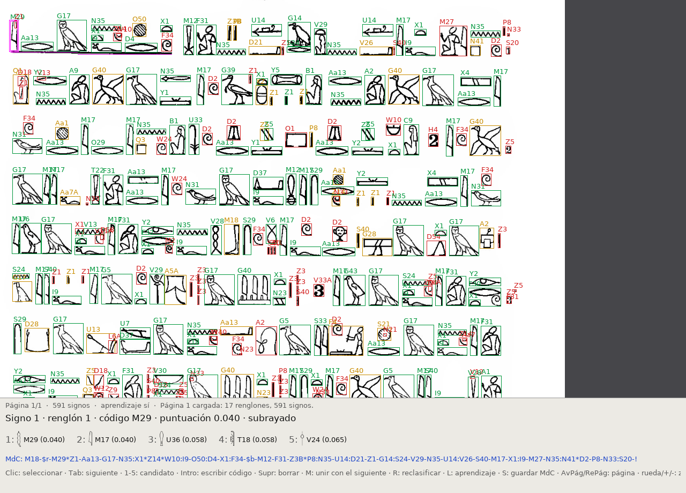

# hieroocr — OCR de jeroglíficos egipcios a MdC

Programa en C con SDL2. Lee un **PDF** o una **imagen** (JPG, PNG, TIFF…) con texto
jeroglífico impreso en renglones horizontales y escribe la transcripción en
**Manuel de Codage** (MdC), lista para pegar en JSesh.

```
hieroocr -p 71 moldenke.pdf -o pagina71.mdc      # una página
hieroocr -p 71-92 moldenke.pdf -o texto.mdc      # un rango de páginas
hieroocr -g moldenke.pdf                         # interfaz para revisar y enseñar
```



## Cómo funciona

1. **Entrada**: las imágenes se cargan con SDL2_image. Los PDF se rasterizan con
   `pdftoppm` (poppler-utils), por defecto a 300 ppp.
2. **Binarización** por el método de Otsu.
3. **Renglones** por perfil de proyección horizontal. Se unen los fragmentos de un
   mismo renglón y se descartan las bandas bajas, como los números de página.
4. **Subrayados**: los trazos horizontales más largos que 1,2 renglones se borran y se
   recuerdan. Los signos que quedan encima salen entre `$r … $b`, porque en las ediciones
   así se marca la tinta roja.
5. **Signos**: componentes conexas con un radio de unión pequeño, para soldar trazos
   rotos. Se filtran motas, restos de subrayado y marcas de lápiz.
6. **Clasificación**: cada signo se normaliza a 40×40 y se compara con todas las
   plantillas. La puntuación combina la distancia de chamfer, la correlación de las
   imágenes suavizadas, la proporción ancho/alto y la altura relativa al renglón
   (menor = mejor). Se guardan los 5 mejores candidatos.
7. **MdC**: los signos que se solapan en horizontal forman un cuadrado. Dentro del
   cuadrado se apilan con `:` y los que comparten piso se unen con `*`. Los cuadrados
   se separan con `-`, cada renglón acaba en `!` y cada página en `!!`.

### Entrenamiento con la lista completa de Gardiner

`datos/gardiner.tsv` contiene los **1072 signos de Gardiner codificados en Unicode**,
con código, punto Unicode, sección, valores fonéticos y descripción. Sus fuentes son:

- [Wikipedia: *List of Egyptian hieroglyphs*](https://en.wikipedia.org/wiki/List_of_Egyptian_hieroglyphs),
  secciones A–NU9: código, Unicode, fonograma y descripción. Las 575 filas extraídas
  coinciden una a una con `UnicodeData.txt`.
- [Wikipedia: *Gardiner's sign list*](https://en.wikipedia.org/wiki/Gardiner%27s_sign_list)
  y [*Egyptian biliteral signs*](https://en.wikipedia.org/wiki/Egyptian_biliteral_signs) /
  [*triliteral signs*](https://en.wikipedia.org/wiki/Egyptian_triliteral_signs) /
  [*uniliteral signs*](https://en.wikipedia.org/wiki/Egyptian_uniliteral_signs):
  valores fonéticos de todas las secciones.
- `UnicodeData.txt`: códigos y puntos Unicode de las secciones O–Aa. La página de
  Wikipedia no se pudo leer más allá de NU9, así que esos signos no tienen descripción.

Para entrenar:

```
make entrenar            # o: ./hieroocr --entrenar [-L lista.tsv] [-f fuente.ttf] [-m modelo.hmod]
```

Para cada signo de la lista se dibuja su glifo y se generan **11 variantes** que imitan
cómo cambia un signo impreso de una edición a otra: original, contorno fino, contorno
grueso, trazo grueso, trazo fino, girado ±4°, más ancho, más estrecho y contorno girado
±3°. Se guardan normalizadas (40×40, 1 bit/píxel) en `datos/modelo.hmod`, unas 10 700
plantillas en ~2,5 MB. El modelo se carga solo al arrancar y ya no hace falta la fuente
ni `UnicodeData.txt` para reconocer.

Al terminar se evalúa con **muestras nuevas**: otra resolución (56 px en lugar de 96) y
estilo, giro, proporción y ruido de bordes aleatorios. También se puede repetir con
`./hieroocr --evaluar`.

| | acierto 1º | entre los 5 primeros |
|---|---|---|
| sin entrenar (1 plantilla por signo) | 71,5 % | 88,1 % |
| modelo entrenado (11 variantes) | **82,4 %** | **93,7 %** |

Los fallos que quedan son sobre todo signos casi gemelos: C6/C7, D4/D5, V30/V31 (cesto
sin o con asa), S40/S41, NL7/NL8 (emblemas en espejo)… `HIEROOCR_FALLOS=1 ./hieroocr --evaluar`
los lista.

**Límite del entrenamiento sintético:** el modelo aprende a reconocer *los dibujos de la
fuente* con variaciones de grosor, giro y proporción. Una tipografía antigua con otro
diseño de los signos (como la de Moldenke, 1898) sigue necesitando las plantillas
aprendidas de la propia edición, que se crean con la interfaz. En la página 67 de
Moldenke el modelo acierta algunos signos más y falla otros, sin una mejora clara. En
cambio, un solo junco M17 corregido a mano hizo reconocer 35 de una página.

### Entrenamiento con fotografías reales (EgyptianHieroglyphicText)

hieroocr puede entrenarse también con el conjunto de datos de
**R. Fuentes-Ferrer, J. Duque-Domingo y P. J. Herrera**,
[EgyptianHieroglyphicText](https://github.com/rfuentesfe/EgyptianHieroglyphicText):
9 704 fotografías de jeroglíficos en estelas de piedra (relieve o pintura), en
310 carpetas por código de Gardiner. No es un modelo ya entrenado (los autores usan
redes neuronales), sino datos etiquetados, que hieroocr convierte en plantillas:

```
make entrenar-fotos      # descarga el conjunto en terceros/ y crea datos/modelo_fotos.hmod
# o bien: ./hieroocr --entrenar -D ruta/EgyptianHieroglyphicText/dataset -m datos/modelo_fotos.hmod
```

Como son fotos con luz y sombras y no tinta sobre papel, de cada una se extrae el
**contorno** del signo: suavizado, bordes de Sobel con umbral adaptativo y limpieza de
manchas. Esos contornos se añaden al modelo junto a las variantes de la fuente, en
total unas 20 400 plantillas. Tarda alrededor de un minuto.

Evaluación con **1 de cada 5 fotos reservadas** (no usadas al entrenar):
`./hieroocr --evaluar -D …/dataset`

| | acierto 1º | entre los 5 primeros |
|---|---|---|
| sólo la fuente | 6,7 % | 18,8 % |
| fuente + 7 887 fotos de entrenamiento | **51,9 %** | **79,2 %** |

Es útil también con texto impreso de **signos huecos**: en el primer renglón de la
página 67 de Moldenke, los signos correctos y en orden pasan del 34 % (modelo de la
fuente) al **48 %** (con fotos). A cambio, con signos dibujados como la fuente
Unicode el acierto sintético baja del 82,4 % al 72,7 %. Por eso hay dos modelos:

- `datos/modelo_fotos.hmod` (fuente y fotos): se carga **por defecto si existe**. Es
  el mejor para inscripciones y ediciones con signos huecos.
- `datos/modelo.hmod` (solo fuente): se elige con `-m datos/modelo.hmod`. Es el mejor
  para tipos parecidos a las fuentes Unicode.

El repositorio de los datos no declara una licencia, así que ni las fotos ni el modelo
derivado de ellas se distribuyen aquí: se descargan y se entrenan en local. Si los usas
en un trabajo, cita a los autores:

> R. Fuentes-Ferrer, J. Duque-Domingo, P. J. Herrera (2025). *Recognition of Egyptian
> Hieroglyphic Texts through Focused Generic Segmentation and Cross-Validation Voting*.
> Applied Soft Computing, 171, 112793. https://doi.org/10.1016/j.asoc.2025.112793

### Plantillas

- **Del modelo entrenado**: `datos/modelo_fotos.hmod` si existe, si no `datos/modelo.hmod`;
  véase arriba.
- **De la fuente**, si no hay modelo: al arrancar se dibujan los 1071 signos de *Noto Sans Egyptian
  Hieroglyphs*. El código Gardiner de cada uno sale de su nombre en `UnicodeData.txt`
  (`EGYPTIAN HIEROGLYPH AA013` → `Aa13`). Unos 220 signos frecuentes tienen
  preferencia; con `-A` se tratan todos por igual.
- **Aprendidas**: cada vez que corriges un signo en la interfaz, su imagen se guarda en
  `plantillas/` (`G17__0.950__…png`). Como salen de la misma edición y tipografía,
  pesan bastante más que las de la fuente.

**Importante:** con solo las plantillas de la fuente el acierto es modesto, porque la
tipografía de cada edición difiere mucho del dibujo de Noto. El uso previsto es este:
corriges unas decenas de signos en las primeras páginas, pulsas **R** para reclasificar
y las páginas siguientes salen mucho mejor. En la prueba con Moldenke, enseñar **un solo**
junco (M17) hizo que se reconocieran 35 de una página que antes daba 1.

## Compilar

Dependencias: SDL2, SDL2_image, SDL2_ttf, `pkg-config`, un compilador C11 y, para los
PDF, `pdftoppm`.

**Debian / Ubuntu**
```
sudo apt install build-essential pkg-config libsdl2-dev libsdl2-image-dev \
                 libsdl2-ttf-dev poppler-utils fonts-noto-core unicode-data
make
```

**Fedora**: `sudo dnf install SDL2-devel SDL2_image-devel SDL2_ttf-devel poppler-utils google-noto-sans-egyptian-hieroglyphs-fonts`
y descarga `UnicodeData.txt` de unicode.org.

**macOS (Homebrew)**: `brew install sdl2 sdl2_image sdl2_ttf poppler pkg-config`. Descarga
la fuente Noto Sans Egyptian Hieroglyphs y `UnicodeData.txt` y pásalas con `-f` y `-U`
(o déjalas en `datos/`).

**Windows**: MSYS2/MinGW con los paquetes `mingw-w64-x86_64-SDL2`, `-SDL2_image`,
`-SDL2_ttf` y `-poppler`, y `make`.

Si la fuente o `UnicodeData.txt` no están en las rutas habituales, el programa los busca
también en el directorio actual y en `datos/`.

## Uso

```
hieroocr [opciones] entrada.(pdf|jpg|png|...)

  -o FICHERO   escribe el MdC en FICHERO (por defecto, salida estándar;
               en la interfaz, salida.mdc)
  -g           abre la interfaz SDL2
  -r PPP       resolución de rasterizado del PDF (300)
  -p PÁGINAS   páginas del PDF: 71 · 71-92 · 71- (hasta el final) ·
               -10 (desde el principio) · listas: 3,5,7-9
  -f FUENTE    fuente jeroglífica TTF
  -U FICHERO   UnicodeData.txt
  -t CARPETA   plantillas aprendidas (./plantillas)
  -F           sólo plantillas aprendidas (sin la fuente)
  -A           no favorecer los signos frecuentes
  -j PX        radio de unión de trazos (automático)
  -a PX        área mínima de un signo (automática)
  -R           texto de derecha a izquierda
  -u           añade ++?+s tras los cuadrados con signos dudosos
  -T UMBRAL    umbral de duda (0.11)
  -m MODELO    modelo entrenado (datos/modelo_fotos.hmod si existe, si no datos/modelo.hmod)
  -D CARPETA   fotos por código Gardiner para --entrenar / --evaluar
  -L LISTA     lista de signos de Gardiner (datos/gardiner.tsv)
  --entrenar   entrena el modelo con todos los signos de la lista y lo evalúa
  --evaluar    mide el acierto del modelo con muestras sintéticas nuevas
```

Sin `-p`, un PDF se procesa entero página a página. Con libros largos conviene
indicar el rango que interesa, por ejemplo `-p 71-92` para la transcripción
jeroglífica de Moldenke.

Con varias páginas, el MdC lleva antes de cada una un comentario con su número
**real** en el PDF (`++página 71+s-!`), y cada página termina en `!!`. En la
interfaz, AvPág y RePág recorren solo las páginas del rango, y **S** guarda el MdC
de todas ellas en un único fichero. Las páginas fuera del documento se avisan y se
omiten.

## Interfaz

| Acción | Tecla / ratón |
|---|---|
| Seleccionar signo | clic izquierdo · Tab / Mayús+Tab |
| Aceptar el candidato *n* | 1 … 5 |
| Escribir el código a mano | Intro, código Gardiner, Intro (Esc cancela) |
| Borrar un signo (mota, número de línea…) | Supr |
| Unir con el signo siguiente (signo partido) | M |
| Reclasificar la página con lo aprendido | R |
| Activar o desactivar el aprendizaje | L |
| Guardar el MdC de todo el documento | S |
| Cambiar de página | AvPág / RePág |
| Zoom / mover / ajustar | rueda o + −, botón derecho arrastrando o flechas, F |
| Salir | Q |

El panel inferior muestra la descripción y el valor fonético del signo seleccionado y
de sus candidatos (por ejemplo `G17 [m]`), sacados de la lista de Wikipedia.

Colores de los recuadros: **verde** = seguro, **ámbar** = dudoso, **rojo** = muy dudoso,
**azul** = corregido por ti. Las líneas magenta son los subrayados detectados.

## Limitaciones

- Solo texto en renglones horizontales. Las columnas verticales no están soportadas;
  `-R` invierte el sentido de lectura.
- No distingue las cifras y letras latinas de la página (números de línea, marcas
  marginales): salen como signos y se borran con Supr.
- Los cuadrados complejos (un signo grande junto a una pila de dos pequeños) pueden
  agruparse de forma distinta a como lo haría un editor humano.
- Las lagunas, los signos restituidos y los facsímiles hieráticos no se detectan.
- Sin plantillas aprendidas, el resultado es un borrador que hay que revisar.
